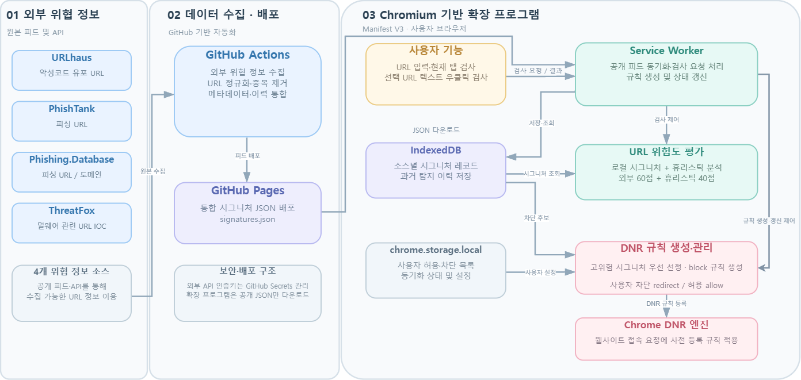

<div align="center">
  

# SafeURLink

**안전한 인터넷을 위한 시그니처 기반 악성 URL 탐지 및 브라우저 보호**

Chrome / Whale 등 Chromium 기반 브라우저에서 URL의 위험도를 분석하고, 알려진 악성 URL로의 접근을 사전에 차단하는 **Manifest V3 확장 프로그램**


</div>

## 1. 프로젝트 소개

**SafeURLink**는 피싱 및 악성코드 유포에 사용되는 URL을 탐지하기 위한 확장 프로그램입니다. 여러 공개 위협 정보 소스에서 수집한 시그니처와 URL 구조를 분석하는 휴리스틱 기법을 결합하여 **위험 점수와 탐지 근거**를 제공하며, 브라우저의 `declarativeNetRequest(DNR)`를 이용하여 일부 고위험 URL의 접속을 차단합니다.

단순히 위험 여부만 표시하는 것이 아니라, 사용자가 **어떤 정보와 특징을 근거로 위험하다고 판단되었는지 확인**하도록 하는 데 중점을 두었습니다.

> [!IMPORTANT]
> **`No Threat Detected`는 안전하다는 보증이 아닙니다.** 현재 수집된 데이터와 구현된 분석 기준에서 위협을 발견하지 못했다는 의미입니다. 알려지지 않은 악성 URL이나 시그니처에 포함되지 않은 URL은 탐지되지 않을 수 있습니다.

## 2. 주요 기능

| 기능 | 설명 |
| --- | --- |
| **URL 검사** | 주소 직접 입력, 현재 탭 URL 검사, 웹페이지의 링크 또는 선택한 URL 문자열 우클릭 검사 |
| **위험도 분석** | 외부 시그니처 최대 60점 + URL 휴리스틱 최대 40점으로 총 100점 산정 |
| **탐지 근거 제공** | 시그니처 출처, 교차 탐지 여부, 의심스러운 문자열·구조적 특징 표시 |
| **실시간 브라우저 보호** | DNR 규칙으로 선정된 외부 악성 URL에 대한 페이지 이동 요청을 사전 차단 |
| **사용자 차단 및 예외 설정** | 사용자 차단 도메인 경고 페이지, 허용·차단 목록 관리, 특정 탭·URL에 대한 세션 예외 |
| **시그니처 자동 갱신** | GitHub Actions로 위협 정보를 수집·배포하고 확장 프로그램의 IndexedDB에 반영 |
| **시그니처 이력 관리** | 갱신 시 과거 등록 이력을 보존하고 오래되거나 비활성화된 기록은 별도로 취급 |

### 검사 결과 구분

| 판정 | 의미 |
| --- | --- |
| `Malicious` | 유효한 외부 악성 시그니처에 일치하거나 사용자가 차단한 도메인 |
| `Suspicious` | 명확한 최신 악성 탐지가 없지만 위험 점수가 **30점 이상**이거나 과거 악성 등록 이력만 존재하는 경우 |
| `No Threat Detected` | 현재 기준에서 명확한 악성 탐지가 없고 위험 점수가 **30점 미만**인 경우. 사용자 허용 목록에 의한 예외도 포함 |

외부 시그니처가 현재 유효하게 일치하면 점수와 관계없이 `Malicious`로 판정합니다. 점수 배점은 프로젝트의 설계 기준이며, 독립된 실제 데이터로 최적화된 가중치는 아닙니다.

## 3. 시스템 구성

<div align="center">
  
</div>

SafeURLink는 **외부 위협 정보 수집·배포 계층**과 **Chromium 기반 브라우저 확장 프로그램 계층**으로 구성됩니다.

## 4. 설치 및 실행

### 실행 환경

- **브라우저:** Chrome 121 이상 또는 호환되는 Chromium 기반 브라우저 (주요 기능은 **Whale에서 검증**)
- **개발 방식:** Chrome Extension Manifest V3
- **사용 기술:** JavaScript, HTML, CSS, IndexedDB, `chrome.storage.local`, DNR API
- **Node.js 20 이상:** 개발·테스트 및 시그니처 수집 스크립트 실행 시 필요. **확장 프로그램을 설치해서 사용하는 것만으로는 필요하지 않습니다.**

### 확장 프로그램 설치

1. 저장소를 다운로드하거나 복제합니다.

   ```bash
   git clone https://github.com/heesung-wo/SafeURLink.git
   ```

2. Chrome의 `chrome://extensions` 또는 Whale의 확장 프로그램 관리 화면에 접속하여 **개발자 모드**를 켭니다.
3. **압축 해제된 확장 프로그램 로드**를 클릭합니다.
4. 저장소 안의 **`safe-ur-link/` 폴더**를 선택합니다. (`manifest.json`이 있는 폴더를 선택해야 합니다.)
5. SafeURLink의 **설정 → 위협 정보 업데이트 → 지금 업데이트**를 실행하여 최신 시그니처 데이터 및 규칙 적용 상태를 확인합니다.

> [!NOTE]
> 저장소에 포함된 `safe-ur-link/public/signatures.json`은 **2건의 시연용 데이터**입니다. 실제 공개 시그니처 피드는 GitHub Pages에서 별도로 수신합니다. 다운로드 또는 갱신이 실패하면 설정 화면의 상태를 확인하세요. 기존 설치 데이터가 필요하다면 확장 프로그램을 삭제하지 말고 해당 폴더의 파일을 변경한 다음 **새로고침**하세요.

### 사용 방법

1. **직접 검사:** 툴바의 SafeURLink 아이콘을 클릭하고 검사할 URL을 입력한 다음 **검사**를 누릅니다.
2. **현재 탭 검사:** 팝업에서 **현재 탭 검사**를 누르면 활성 탭의 URL을 평가합니다.
3. **우클릭 검사:** 웹페이지의 링크를 우클릭하거나 URL 문자열을 선택한 뒤 SafeURLink 검사 메뉴를 사용합니다.
4. **실시간 보호:** 설정에서 보호 기능을 활성화하면 선정된 고위험 URL의 접속이 DNR 규칙에 따라 차단됩니다.
5. **개인 설정:** 설정에서 허용·차단 도메인을 한 줄에 하나씩 입력하고 저장할 수 있습니다.

**안전한 기능 시연:** 실제 악성 사이트에 방문하지 마세요. 사용자 경고 페이지는 일반 테스트용 도메인을 사용자 차단 목록에 넣어 확인할 수 있으며, 외부 시그니처 차단 규칙은 실제 URL 접속 대신 DNR의 `testMatchOutcome()` 가상 요청으로 검증할 수 있습니다.

## 5. 위험도 산정 방식

최종 점수는 다음과 같이 계산합니다.

```text
위험 점수 (0~100)
  = 외부 위협 정보 기반 점수 (최대 60)
  + URL 휴리스틱 점수      (최대 40)
```

| 구분 | 분석 항목 | 점수 |
| --- | --- | ---: |
| 외부 시그니처 | 최초 일치 | +30 |
| 외부 시그니처 | 두 번째 출처 교차 탐지 | +10 |
| 외부 시그니처 | 세 번째·네 번째 출처 교차 탐지 | 각 +5 (최대 +10) |
| 외부 시그니처 | 검증 상태·활성 여부·신뢰도·최신성 | 최대 +10 |
| 휴리스틱 | IP 주소 직접 사용 / Punycode 도메인 | 각각 +8 |
| 휴리스틱 | `@`를 이용한 주소 혼동 | +6 |
| 휴리스틱 | 과도한 서브도메인 / 의심 키워드 | 각각 +5 |
| 휴리스틱 | 긴 URL | +4 |
| 휴리스틱 | 과도한 인코딩·특수문자 / HTTP 사용 | 각각 +2 |

휴리스틱은 여러 특징의 점수를 합산한 후 최대 40점으로 제한합니다. 일반적인 URL 구조에도 일부 특징이 존재할 수 있으므로 휴리스틱만으로 악성 여부를 확정하지 않습니다.

## 6. 시그니처 수집과 실시간 보호 범위

### 위협 정보 출처

| 출처 | 활용 목적 |
| --- | --- |
| [URLhaus](https://urlhaus.abuse.ch/) | 악성코드 유포 관련 URL 위협 정보 |
| [PhishTank](https://phishtank.org/) | 피싱 URL 및 검증 관련 정보 |
| [Phishing.Database](https://github.com/Phishing-Database/Phishing.Database) | 피싱 URL 목록 |
| [ThreatFox](https://threatfox.abuse.ch/) | 악성 침해 지표 기반 URL 정보 |

GitHub Actions에서 원본 데이터를 처리하므로 **일반 확장 프로그램 사용자는 외부 위협 정보 API 키를 발급받을 필요가 없습니다.** 

- **GitHub Actions 예약 수집:** 한국 시간 기준 매일 **00:17** 실행하도록 설정 (`.github/workflows/update-signatures.yml`). 예약 작업은 지연되거나 누락될 수 있습니다.
- **브라우저 측 자동 확인:** 한국 시간 기준 매일 **15:00** 공개 피드 확인. 브라우저가 종료되어 시각을 놓친 경우 다음 시작 시 보충 확인하도록 설계되었습니다.
- **수동 갱신:** 확장 프로그램 설정의 **지금 업데이트** 버튼으로 갱신 요청 가능.

### DNR 규칙 상한

로컬 DB에 저장된 모든 URL을 브라우저 차단 규칙으로 등록하지는 않습니다. 실시간 보호 대상은 시그니처의 활성 여부·최신성·검증 여부 등과 브라우저의 규칙 개수 제한을 고려하여 선정합니다.

| 출처 | 실시간 보호 후보 선정 상한 |
| --- | ---: |
| URLhaus | 9,000 |
| PhishTank | 9,000 |
| Phishing.Database (`PhishingDB`) | 9,000 |
| ThreatFox | 2,700 |
| **외부 시그니처 규칙 합계 상한** | **29,700** |

별도로 사용자 차단 도메인은 최대 **300개**까지 관리할 수 있으며, 허용 규칙도 포함하여 전체 동적 DNR 규칙 수는 코드상 **30,000개**로 제한합니다. 여러 출처에 같은 URL이 있거나 필터에 적용할 수 없는 URL이 있는 경우 실제 규칙 수는 상한보다 적을 수 있습니다. 외부 위협 규칙은 주로 **정확한 URL과 최상위 페이지 이동(`main_frame`)**을 대상으로 하므로, 한 URL이 등록되어 있다고 해서 동일 도메인의 모든 경로가 차단되는 것은 아닙니다.

## 7. 프로젝트 구조

```text
SafeURLink/
├── .github/
│   └── workflows/
│       └── update-signatures.yml    # 위협 정보 수집 · 배포 자동화
├── safe-ur-link/                  # 확장 프로그램 루트 (manifest.json 위치)
│   ├── manifest.json
│   ├── background/
│   │   └── background.js          # Service Worker · 메시지 · 보호 규칙 관리
│   ├── core/
│   │   ├── common.js              # URL 정규화 · 휴리스틱 · 위험도 계산
│   │   ├── db.js                  # IndexedDB 시그니처 관리
│   │   ├── dnr.js                 # DNR 차단 후보 선정 · 규칙 생성
│   │   ├── feeds.js               # 원본 위협 정보 수집
│   │   ├── remote-feed.js         # 배포된 JSON 검증 · 다운로드
│   │   └── daily-sync.js          # 자동 갱신 일정
│   ├── pages/                     # popup · result · warning · options
│   ├── shared/                    # 공통 화면 구성
│   ├── assets/                    # CSS · 확장 프로그램 아이콘
│   ├── scripts/                   # 피드 빌드 · CSV 내보내기
│   ├── public/                    # GitHub Pages 배포 파일
│   ├── tests/
│   │   ├── 기능_테스트/
│   │   ├── 대량_평가_테스트/
│   │   └── 추가_정량검증/
│   └── package.json
├── README.md
├── system-architecture.png
└── SafeURLink_최종결과_보고서_프로토(20261114-093845).docx
```

---

**SafeURLink는 학술·교육 목적의 졸업작품입니다.** 실제 보안 제품의 완전한 대체 수단이 아니며, 검사 결과가 특정 URL의 안전성을 보증하지 않습니다.
